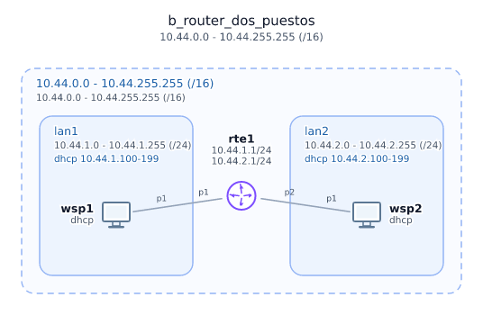

# Laboratorio `b_router_dos_puestos`

Lo que se aprendió ejecutándolo va debajo de la tabla. La tabla se genera con
`./netlabs docs` y no se edita a mano: sale de la declaración.

<!-- netlabs:begin -- generado por `./netlabs docs`; no se edita a mano -->

## b_router_dos_puestos
Address spaces: `10.44.0.0/16`

### Topología

También en vector: [`b_router_dos_puestos-topologia.svg`](b_router_dos_puestos-topologia.svg).

*cada área es una red; su cabecera dice la subred y el rango que reparte. Cada equipo lleva escrito lo que no cambia —su dirección estática, o `dhcp`— y la forma de su símbolo dice su clase. La línea dice que están conectados y va sin flechas: el plano no inventa un sentido de tráfico.*

### Networks

| network | address |
| --- | --- |
| `lan1` | `10.44.1.0/24` |
| `lan2` | `10.44.2.0/24` |

### Nodes

| role | type | stage | interfaces | address | resources |
| --- | --- | --- | --- | --- | --- |
| `rte1` | router | 1 | `lan1`, `lan2` | management (derived) | cores=2, disk=1, memory=512 |
| `wsp1` | workstation | 2 | `lan1` | from router (DHCP) | cores=1, disk=2, memory=256 |
| `wsp2` | workstation | 2 | `lan2` | from router (DHCP) | cores=1, disk=2, memory=256 |

### Cables

| bridge | a | z | network |
| --- | --- | --- | --- |
| `b_rte1p1_wsp1p1` | `rte1p1` | `wsp1p1` | `10.44.1.0/24` |
| `b_rte1p2_wsp2p1` | `rte1p2` | `wsp2p1` | `10.44.2.0/24` |

Configured areas: `addresses`, `dhcp_server`, `services`, `snmp`, `users`.

<!-- netlabs:end -->
