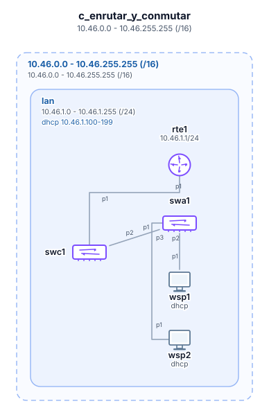

# Laboratorio `c_enrutar_y_conmutar`

Lo que se aprendió ejecutándolo va debajo de la tabla. La tabla se genera con
`./netlabs docs` y no se edita a mano: sale de la declaración.

<!-- netlabs:begin -- generado por `./netlabs docs`; no se edita a mano -->

## c_enrutar_y_conmutar
Address spaces: `10.46.0.0/16`

### Topología

*cada área es una red; su cabecera dice la subred y el rango que reparte. Cada equipo lleva escrito lo que no cambia —su dirección estática, o `dhcp`— y la forma de su símbolo dice su clase. La línea dice que están conectados y va sin flechas: el plano no inventa un sentido de tráfico.*

### Networks

| network | address |
| --- | --- |
| `lan` | `10.46.1.0/24` |

### Nodes

| role | type | stage | interfaces | address | resources |
| --- | --- | --- | --- | --- | --- |
| `rte1` | router | 1 | `lan` | management (derived) | cores=2, disk=1, memory=512 |
| `swa1` | switch | 2 | `lan`, `lan`, `lan` | management (derived) | cores=2, disk=1, memory=512 |
| `swc1` | switch | 2 | `lan`, `lan` | management (derived) | cores=2, disk=1, memory=512 |
| `wsp1` | workstation | 3 | `lan` | from router (DHCP) | cores=1, disk=2, memory=256 |
| `wsp2` | workstation | 3 | `lan` | from router (DHCP) | cores=1, disk=2, memory=256 |

### Cables

| bridge | a | z | network |
| --- | --- | --- | --- |
| `c_rte1p1_swc1p1` | `rte1p1` | `swc1p1` | `10.46.1.0/24` |
| `c_swc1p2_swa1p1` | `swc1p2` | `swa1p1` | `10.46.1.0/24` |
| `c_swa1p2_wsp1p1` | `swa1p2` | `wsp1p1` | `10.46.1.0/24` |
| `c_swa1p3_wsp2p1` | `swa1p3` | `wsp2p1` | `10.46.1.0/24` |

Configured areas: `addresses`, `dhcp_server`, `services`, `snmp`, `users`.

<!-- netlabs:end -->
