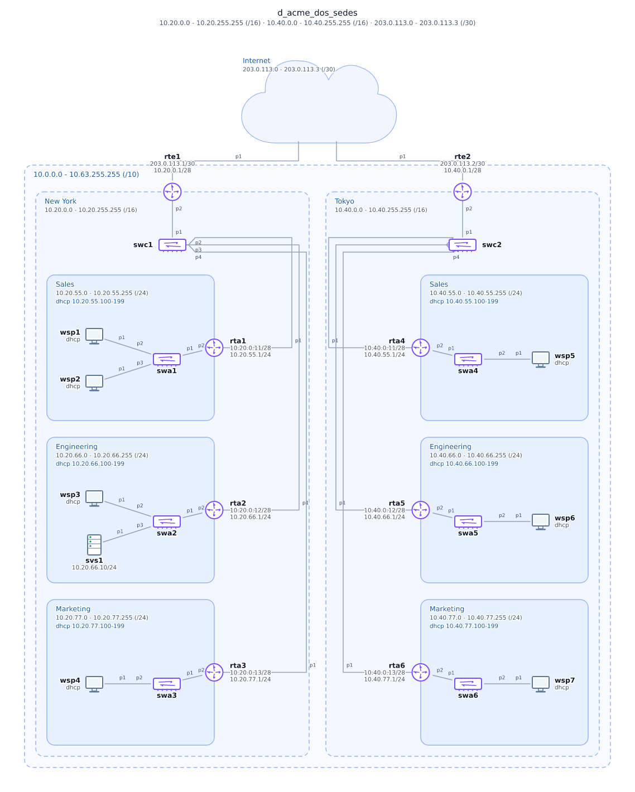

# Laboratorio `d_acme_dos_sedes`

Lo que se aprendió ejecutándolo va debajo de la tabla. La tabla se genera con
`./netlabs docs` y no se edita a mano: sale de la declaración.

<!-- netlabs:begin -- generado por `./netlabs docs`; no se edita a mano -->

## d_acme_dos_sedes
Address spaces: `10.20.0.0/16`, `10.40.0.0/16`, `203.0.113.0/30`

### Topología

También en vector: [`d_acme_dos_sedes-topologia.svg`](d_acme_dos_sedes-topologia.svg).

*cada área es una red; su cabecera dice la subred y el rango que reparte. Cada equipo lleva escrito lo que no cambia —su dirección estática, o `dhcp`— y la forma de su símbolo dice su clase. La línea dice que están conectados y va sin flechas: el plano no inventa un sentido de tráfico.*

### Networks

| network | address |
| --- | --- |
| `transito` | `203.0.113.0/30` |
| `ny` | `10.20.0.0/16` |
| `ny_ventas` | `10.20.55.0/24` |
| `ny_ingenieria` | `10.20.66.0/24` |
| `ny_marketing` | `10.20.77.0/24` |
| `tk` | `10.40.0.0/16` |
| `tk_ventas` | `10.40.55.0/24` |
| `tk_ingenieria` | `10.40.66.0/24` |
| `tk_marketing` | `10.40.77.0/24` |

### Nodes

| role | type | stage | interfaces | address | resources |
| --- | --- | --- | --- | --- | --- |
| `rte1` | router | 1 | `transito`, `ny` | management (derived) | cores=1, disk=1, memory=256 |
| `rte2` | router | 1 | `transito`, `tk` | management (derived) | cores=1, disk=1, memory=256 |
| `rta1` | router | 2 | `ny`, `ny_ventas` | management (derived) | cores=1, disk=1, memory=256 |
| `rta2` | router | 2 | `ny`, `ny_ingenieria` | management (derived) | cores=1, disk=1, memory=256 |
| `rta3` | router | 2 | `ny`, `ny_marketing` | management (derived) | cores=1, disk=1, memory=256 |
| `rta4` | router | 2 | `tk`, `tk_ventas` | management (derived) | cores=1, disk=1, memory=256 |
| `rta5` | router | 2 | `tk`, `tk_ingenieria` | management (derived) | cores=1, disk=1, memory=256 |
| `rta6` | router | 2 | `tk`, `tk_marketing` | management (derived) | cores=1, disk=1, memory=256 |
| `swc1` | switch | 2 | `ny`, `ny`, `ny`, `ny` | management (derived) | cores=1, disk=1, memory=256 |
| `swc2` | switch | 2 | `tk`, `tk`, `tk`, `tk` | management (derived) | cores=1, disk=1, memory=256 |
| `swa1` | switch | 3 | `ny_ventas`, `ny_ventas`, `ny_ventas` | management (derived) | cores=1, disk=1, memory=256 |
| `swa2` | switch | 3 | `ny_ingenieria`, `ny_ingenieria`, `ny_ingenieria` | management (derived) | cores=1, disk=1, memory=256 |
| `swa3` | switch | 3 | `ny_marketing`, `ny_marketing` | management (derived) | cores=1, disk=1, memory=256 |
| `swa4` | switch | 3 | `tk_ventas`, `tk_ventas` | management (derived) | cores=1, disk=1, memory=256 |
| `swa5` | switch | 3 | `tk_ingenieria`, `tk_ingenieria` | management (derived) | cores=1, disk=1, memory=256 |
| `swa6` | switch | 3 | `tk_marketing`, `tk_marketing` | management (derived) | cores=1, disk=1, memory=256 |
| `svs1` | server | 4 | `ny_ingenieria` | `10.20.66.10/24` | cores=1, disk=4, memory=256 |
| `wsp1` | workstation | 4 | `ny_ventas` | from router (DHCP) | cores=1, disk=2, memory=128 |
| `wsp2` | workstation | 4 | `ny_ventas` | from router (DHCP) | cores=1, disk=2, memory=128 |
| `wsp3` | workstation | 4 | `ny_ingenieria` | from router (DHCP) | cores=1, disk=2, memory=128 |
| `wsp4` | workstation | 4 | `ny_marketing` | from router (DHCP) | cores=1, disk=2, memory=128 |
| `wsp5` | workstation | 4 | `tk_ventas` | from router (DHCP) | cores=1, disk=2, memory=128 |
| `wsp6` | workstation | 4 | `tk_ingenieria` | from router (DHCP) | cores=1, disk=2, memory=128 |
| `wsp7` | workstation | 4 | `tk_marketing` | from router (DHCP) | cores=1, disk=2, memory=128 |

### Cables

| bridge | a | z | network |
| --- | --- | --- | --- |
| `d_rte1p1_rte2p1` | `rte1p1` | `rte2p1` | `203.0.113.0/30` |
| `d_rte1p2_swc1p1` | `rte1p2` | `swc1p1` | `10.20.0.0/16` |
| `d_swc1p2_rta1p1` | `swc1p2` | `rta1p1` | `10.20.0.0/16` |
| `d_swc1p3_rta2p1` | `swc1p3` | `rta2p1` | `10.20.0.0/16` |
| `d_swc1p4_rta3p1` | `swc1p4` | `rta3p1` | `10.20.0.0/16` |
| `d_rte2p2_swc2p1` | `rte2p2` | `swc2p1` | `10.40.0.0/16` |
| `d_swc2p2_rta4p1` | `swc2p2` | `rta4p1` | `10.40.0.0/16` |
| `d_swc2p3_rta5p1` | `swc2p3` | `rta5p1` | `10.40.0.0/16` |
| `d_swc2p4_rta6p1` | `swc2p4` | `rta6p1` | `10.40.0.0/16` |
| `d_rta1p2_swa1p1` | `rta1p2` | `swa1p1` | `10.20.55.0/24` |
| `d_swa1p2_wsp1p1` | `swa1p2` | `wsp1p1` | `10.20.55.0/24` |
| `d_swa1p3_wsp2p1` | `swa1p3` | `wsp2p1` | `10.20.55.0/24` |
| `d_rta2p2_swa2p1` | `rta2p2` | `swa2p1` | `10.20.66.0/24` |
| `d_swa2p2_wsp3p1` | `swa2p2` | `wsp3p1` | `10.20.66.0/24` |
| `d_swa2p3_svs1p1` | `swa2p3` | `svs1p1` | `10.20.66.0/24` |
| `d_rta3p2_swa3p1` | `rta3p2` | `swa3p1` | `10.20.77.0/24` |
| `d_swa3p2_wsp4p1` | `swa3p2` | `wsp4p1` | `10.20.77.0/24` |
| `d_rta4p2_swa4p1` | `rta4p2` | `swa4p1` | `10.40.55.0/24` |
| `d_swa4p2_wsp5p1` | `swa4p2` | `wsp5p1` | `10.40.55.0/24` |
| `d_rta5p2_swa5p1` | `rta5p2` | `swa5p1` | `10.40.66.0/24` |
| `d_swa5p2_wsp6p1` | `swa5p2` | `wsp6p1` | `10.40.66.0/24` |
| `d_rta6p2_swa6p1` | `rta6p2` | `swa6p1` | `10.40.77.0/24` |
| `d_swa6p2_wsp7p1` | `swa6p2` | `wsp7p1` | `10.40.77.0/24` |

Configured areas: `addresses`, `dhcp_server`, `routes`, `services`, `snmp`, `users`.

<!-- netlabs:end -->

## Lo aprendido ejecutándolo

- **El área `routes` no existía de verdad.** Estaba validada desde el principio, pero el
  motor no tenía ninguna primitiva que la aplicara: un laboratorio que la declaraba se
  desplegaba sin las rutas y sin decir nada. Se añadió `_route_ops` (crea, corrige el
  salto y retira lo marcado que sobra) con sus pruebas, y aquí es lo que hace que las
  dos sedes se vean: `ruta 10.40.0.0/16 -> 10.99.0.2` en `rte1` y la simétrica en `rte2`.
- **Sin switch, un servidor no cabe en un departamento.** Un puerto de router es un
  cable y no se comparte: para que `svs1` y `wsp2` compartan el segmento de ingeniería
  de Nueva York hay un switch de acceso (`swa1`, puente `netlabs-ny_ingenieria`). Las
  demás áreas cuelgan un solo equipo de su puerta.
- **El tránsito es una red más, no un puente especial.** `10.99.0.0/30` con una pata en
  cada router; el camino entre sedes es la ruta estática, no un cable compartido.
- **Los tres espacios se ven desde la gestión**, cada uno con su salto: `10.20.0.0/16`
  por `rte1`, `10.40.0.0/16` por `rte2` y `10.99.0.0/30` por `rte1`. El cruce de
  `10.20.0.0/16` se comprueba contra `svs1` (dirección declarada), así que dice «red» y
  no «salto».
- **Medido**: segundo `apply` con `changed=0`; `rte1` alcanza `10.40.55.199` (puesto de
  ventas de Tokio) con 4/4 y TTL 63, y `rte2` alcanza `10.20.66.10` (el servidor de
  Nueva York) con 4/4 y TTL 63. Las dos sedes se hablan.
- **El plano automático** reparte las áreas alrededor de **cada** router de borde: cada
  sede tiene su salida a Internet, así que los dos routers se apoyan en el techo de la
  empresa a la altura de su sede y no en el mismo punto. Los cables del switch de núcleo
  bajan por el pasillo lateral en vez de cortar en diagonal por el departamento de al
  lado, los clientes de un área con switch cuelgan en columna —en fila, el cable al del
  fondo pasaba por encima del de en medio y el dibujo decía «cadena» donde hay
  «estrella»— y cada router de borde lleva su nombre fuera del hueco de la nube. Lo
  vigilan cinco pruebas de `tests/test_plano.py`: áreas anidadas, equipos dentro de su
  área, la nube fuera de la empresa, ninguna etiqueta montada sobre otra y las dos
  salidas sin apilarse.
