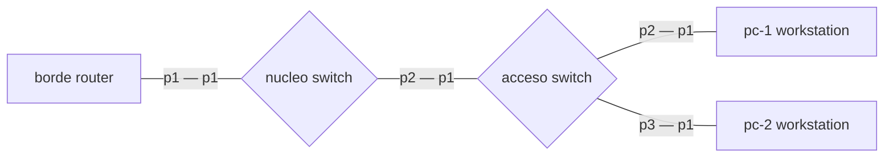

# Laboratorio `dos`

Lo que se aprendió ejecutándolo va debajo de la tabla. La tabla se genera con
`./netlabs docs` y no se edita a mano: sale de la declaración.

<!-- netlabs:begin -- generado por `./netlabs docs`; no se edita a mano -->

## dos
Slot: 1
Address spaces: `10.46.0.0/16`

### Topología

### Cableado (L2)

### Networks

| network | address |
| --- | --- |
| `lan` | `10.46.1.0/24` |

### Nodes

| role | type | stage | interfaces | address | resources |
| --- | --- | --- | --- | --- | --- |
| `borde` | router | 1 | `lan` | management (derived) | cores=1, disk=1, memory=256 |
| `acceso` | switch | 2 | `lan`, `lan`, `lan` | management (derived) | cores=1, disk=1, memory=256 |
| `nucleo` | switch | 2 | `lan`, `lan` | management (derived) | cores=1, disk=1, memory=256 |
| `pc-1` | workstation | 3 | `lan` | from router (DHCP) | cores=1, disk=2, memory=256 |
| `pc-2` | workstation | 3 | `lan` | from router (DHCP) | cores=1, disk=2, memory=256 |

### Cables

| bridge | a | z | network |
| --- | --- | --- | --- |
| `rt11p01_sw11p01` | `rt11p01` | `sw11p01` | `10.46.1.0/24` |
| `sw11p02_sw12p01` | `sw11p02` | `sw12p01` | `10.46.1.0/24` |
| `sw12p02_ws11p01` | `sw12p02` | `ws11p01` | `10.46.1.0/24` |
| `sw12p03_ws12p01` | `sw12p03` | `ws12p01` | `10.46.1.0/24` |

Configured areas: `addresses`, `dhcp_server`, `identity`, `services`, `snmp`, `users`.

<!-- netlabs:end -->

## Lo aprendido ejecutándolo

Un solo dominio de difusión —`lan`, 10.46.1.0/24— repartido por dos switches en serie. El router
tiene **una** pata en él; si tuviera dos estaría conmutando, y para eso está el `switch`.

Comprobado con el laboratorio desplegado el 21-nov-2026 (vmids 107–111):

- Los dos puestos pidieron dirección y la obtuvieron del router: `10.46.1.199` (ws-pc-1) y
  `10.46.1.198` (ws-pc-2), las dos concesiones `bound` en el servidor `netlabs-lan`.
- El cable cruza los dos switches: desde ws-pc-1, `ping 10.46.1.198` da 2/2 y `ping 10.46.1.1`
  (la puerta) da 2/2.
- Dentro de cada switch, el puente es uno y la gestión está fuera: `sw-nucleo` tiene
  `netlabs-lan` con `ether1` y `ether2`, y su dirección en `ether3`; `sw-acceso` lo mismo con
  `ether1`–`ether3` y la dirección en `ether4`.
- La segunda pasada de `apply` no escribe nada (`changed=0`, `failed=0`).

### Trampas pagadas

1. **Un `pve_do` que se cita a sí mismo revienta Ansible.** `wait_task.yml` definía
   `pve_do: "leer la tarea {{ pve_do }}"`; al esperar una tarea el nombre crecía hasta
   «maximum recursion depth exceeded». La frase que se muestra ya no se refiere a sí misma.
2. **La comprobación de la concesión no comprobaba nada.** Buscaba la palabra `inet` en la
   respuesta de `/lxc/<vmid>/interfaces`; el bucle local siempre la lleva, así que daba verde con
   los puestos sin dirección. Ahora exige una IPv4 en una interfaz que no sea `lo`.
3. **Un puesto nace antes de que su router sirva DHCP.** El `dhclient` del invitado se rinde y no
   vuelve; el motor lo reinicia **una vez** y vuelve a sondear. Con el reinicio, los dos puestos
   tomaron dirección.
4. **El switch no puede repetir red igual que un router.** La validación prohibía repetir red para
   no permitir un router con dos patas en la misma red (eso es conmutar); el switch necesita
   justo lo contrario. Ahora el router y el firewall la prohíben, y el switch exige que **todas**
   sus patas sean de la misma red.
5. **Un switch no declara `address`.** Su gestión es la pata OOB derivada del vmid; darle una
   dirección de laboratorio habría puesto una IP en una pata que está dentro del puente, y
   RouterOS no lo permite.
